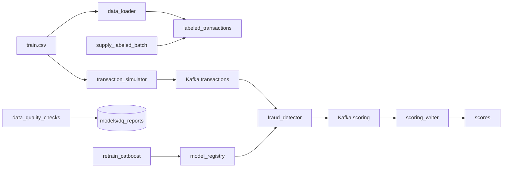

# Антифрод: поток транзакций, скоринг и переобучение

Учебный проект обнаружения мошеннических транзакций. Kafka несёт непрерывный поток событий, CatBoost скорит их текущей моделью, а Airflow по расписанию дописывает размеченные месяцы, переобучает модель и публикует бинарник в каталог, который читает сервис скоринга.

Датасет можно найти [здесь](https://www.kaggle.com/competitions/teta-ml-1-2025/data). В этом задании используется файл `train.csv`. Путь задаётся переменной `TRAIN_DATA_CSV` в `.env`.

## Архитектура



| Сервис | Описание |
|--------|----------|
| **Kafka** | Шина сообщений между симулятором потока, скорингом и записью результатов |
| **Zookeeper** | Управление кластером Kafka |
| **Kafka UI** | Просмотр топиков `transactions` и `scoring` |
| **transaction_simulator** | Бесконечно шлёт в `transactions` случайные строки CSV. У каждой новый `transaction_id` и `transaction_time`, равный текущему моменту, формат `YYYY-MM-DD HH:MM` |
| **fraud_detector** | Препроцессинг и инференс CatBoost. Перед каждым сообщением читает `/models/latest.txt` и подхватывает `my_catboost_<версия>.cbm` без перезапуска |
| **scoring_writer** | Читает топик `scoring` и пишет `score`, `fraud_flag` и `model_version` в PostgreSQL |
| **PostgreSQL** | Витрина `labeled_transactions`, состояние окна `training_state` и таблица `scores` |
| **data_loader** | При старте один раз загружает весь CSV в витрину и собирает исходное окно обучения |
| **airflow** | DAG'и: `supply_labeled_batch` (поставка нового месяца), `retrain_catboost` (переобучение), `data_quality_checks` (DQ-проверки) |

Общий том `model_registry` смонтирован в Airflow как `/opt/airflow/models` и в `fraud_detector` как `/models`. Логика задач вынесена в `pipeline/`. Файлы в `dags/` только связывают задачи.

## Структура проекта

```
.
├── fraud_detector/           # Онлайн-скоринг
├── transaction_simulator/    # Непрерывная поставка транзакций в Kafka
├── scoring_writer/           # Запись скоров в PostgreSQL
├── data_loader/              # Первичная загрузка размеченной витрины
├── dags/
│   ├── retrain_catboost.py
│   ├── supply_labeled_batch.py
│   └── data_quality_checks.py
├── pipeline/
│   ├── db.py
│   ├── settings.py
│   ├── retrain/
│   ├── supply/
│   └── data_quality/
├── airflow/
├── docker-compose.yaml
├── .env.example
└── README.md
```

## Как запустить проект

### 1. Клонировать репозиторий

```bash
git clone <ваш публичный репозиторий>
cd mlops_realtime_fraud_detector_airflow
```

### 2. Создать `.env`

```bash
cp .env.example .env
```

В `.env` укажите `TRAIN_DATA_CSV` - путь к размеченному `train.csv` на вашей машине. Также при необходимости поправьте креды Postgres.

### 3. Запустить контейнеры

```bash
docker compose up --build
```

Первый запуск занимает несколько минут (загрузка витрины, инициализация Airflow).

## Доступные сервисы

| Сервис | URL | Логин/пароль |
|--------|-----|--------------|
| **Kafka UI** | http://localhost:8080 | - |
| **Airflow** | http://localhost:8081 | admin / admin |
| **PostgreSQL** | localhost:5432, база `fraud_db` | из `.env` |

## DAG'и в Airflow

В Airflow доступны 3 DAG:

- `supply_labeled_batch` - раз в 5 минут добавляет в `labeled_transactions` батч из 100000 случайных строк, переносит `transaction_time` в следующий календарный месяц относительно максимальной даты в витрине. Удаляет наблюдения старше 3 лет от самого нового месяца.
- `retrain_catboost` - раз в 5 минут извлекает следующий месяц из витрины (по указателю `training_state`), строит скользящее окно из 3 месяцев (добавляет новый, убирает старый), делит по времени (2 ранних - train, самый свежий - test), обучает CatBoost с тем же препроцессингом (`run_preproc` из `fraud_detector/src`), при улучшении метрик публикует модель. Указатель окна обновляется только после успешной публикации.
- `data_quality_checks` - раз в 10 минут проверяет датасет по DQ-правилам, генерирует HTML-отчёт в `model_registry/dq_reports/` (рядом с каталогом моделей).

Все DAG можно запустить вручную из UI Airflow. `catchup=False`, пропущенные запуски не догоняются.

## Параметры (как в семинаре, свои значения в README)

- Размер батча при поставке: **100000** строк (`pipeline/settings.py:SAMPLE_SIZE`)
- Глубина хранения истории: **3 года** (`pipeline/settings.py:HISTORY_YEARS`)
- Размер окна обучения: **3 месяца** (скользящее)
- Расписание: `supply_labeled_batch` и `retrain_catboost` - раз в 5 минут, `data_quality_checks` - раз в 10 минут

## Проверка работы

### 1. Проверить модели в общем каталоге

```bash
docker compose exec airflow ls -la /opt/airflow/models
```

Должны появиться файлы `my_catboost_<timestamp>.cbm`, `*.metrics.json`, `latest.txt`. Также `dq_reports/` с HTML-отчётами.

### 2. Убедиться, что сервис скоринга подхватывает новую модель

Файл `latest.txt` содержит версию без перезапуска `fraud_detector`. Сервис читает его при каждом сообщении (кеширует модель и перезагружает при смене версии).

### 3. Посмотреть версию модели в результатах скоринга

```sql
SELECT transaction_id, score, fraud_flag, model_version, created_at
FROM scores
ORDER BY created_at DESC
LIMIT 20;
```

В колонке `model_version` должна быть версия `my_catboost_<timestamp>` после публикации модели.

### 4. Просмотр DQ-отчёта

HTML-отчёты лежат в томе `model_registry`, смонтированном в Airflow по пути `/opt/airflow/models/dq_reports/`. Также доступны из контейнера:

```bash
docker compose exec airflow ls -la /opt/airflow/models/dq_reports/
docker compose exec airflow cat /opt/airflow/models/dq_reports/dq_report_*.html | head -30
```

## Data Quality правила (минимум 5)

Реализованные проверки в `pipeline/data_quality/checks.py`:
1. `not_null:transaction_time` - отсутствие пропусков во времени транзакции
2. `not_null:amount` - отсутствие пропусков в сумме
3. `not_null:target` - отсутствие пропусков в целевой переменной
4. `positive:amount` - сумма должна быть положительной
5. `range:lat[-90,90]`, `range:lon[-180,180]` - корректные координаты
6. `allowed_values:gender` - допустимые значения пола
7. `unique:transaction_time` (доп. проверка) - проверка дубликатов по времени

Результаты публикуются в HTML-репорте в директории `models/dq_reports/` рядом с моделями.

## Логика проверки улучшения модели (оценка 8-10)

В `pipeline/retrain/publish_model.py` реализована проверка: перед публикацией новой модели сравниваются метрики с текущей версией из `latest.txt`. При наличии предыдущей метрики и отличии от `initial`:
- Если `roc_auc` обеих моделей определены - новая публикуется только если `roc_auc_new > roc_auc_prev` (с небольшим eps)
- Иначе сравнение идёт по `f1` (`f1_new > f1_prev`)
- Если новая модель не лучше - она **не публикуется**: временные файлы удаляются, `latest.txt` не меняется, окно обучения не сдвигается, `training_state` не обновляется. Задача помечается как `skipped`.

Метрики хранятся в `models/my_catboost_<version>.metrics.json`. Сервис скоринга продолжит использовать предыдущую версию из `latest.txt`.

## Особенности реализации

- **DAG только связывает задачи** - логика в `pipeline/`
- **Повторный запуск не сдвигает окно дважды** - `publish_model` проверяет, перенесён ли `pending_window.parquet` в `current.parquet`; `advance_training_state` вызывается только после публикации
- **Пропуск при отсутствии месяца** - `extract_month_batch` выбрасывает `AirflowSkipException`, если в витрине нет батча по указателю
- **Модель подхватывается без перезапуска** - `fraud_detector/src/scorer.py` следит за `latest.txt` и перезагружает модель при изменении версии
- **Свой препроцессинг** - используется `run_preproc` из `fraud_detector/src` (тот же, что и онлайн-скоринг), что обеспечивает консистентность
- **Сохранение контрактов скоринга** - выход содержит `score`, `fraud_flag`, `model_version`

## Очистка

```bash
docker compose down -v
```

Удаляет контейнеры вместе с витриной, окном обучения, реестром моделей и состоянием Airflow. Следующий запуск снова загрузит CSV.
